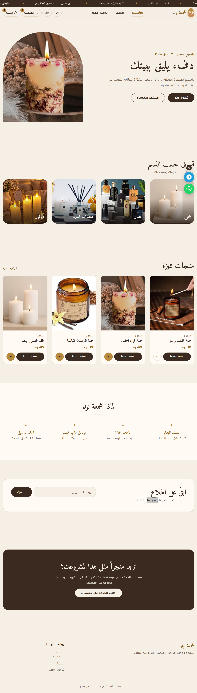
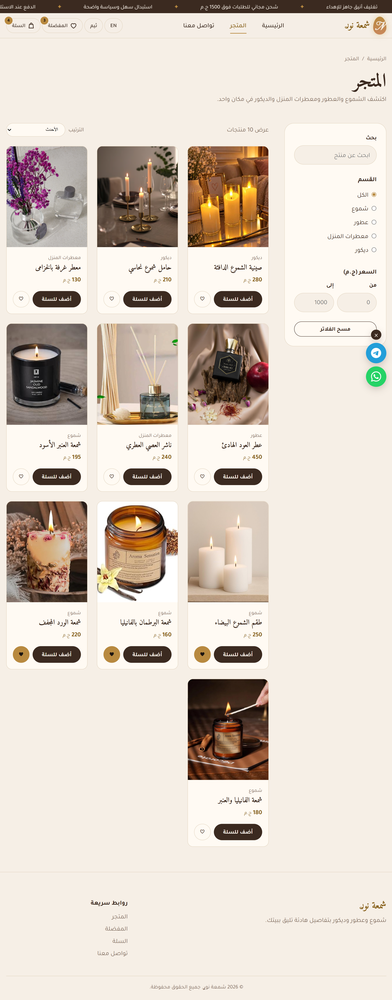
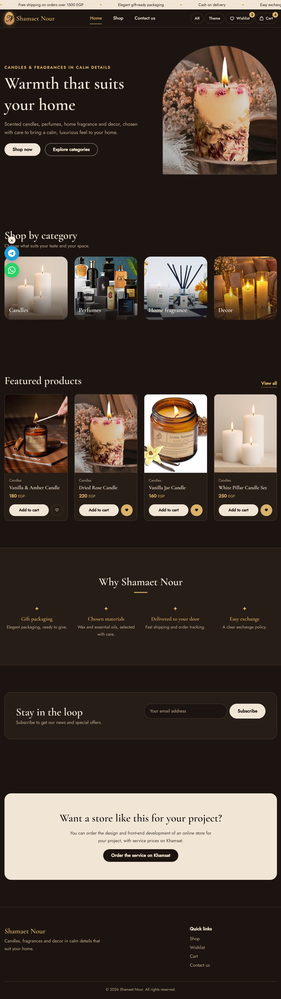

# 🕯️ شمعة نوࢪ | Shamaet Nour

[العربية](#-نبذة-بالعربية) · **English**

A bilingual (Arabic / English) storefront for luxury candles, perfumes, home fragrance and decor. Built as a **front-end only** project with plain HTML, CSS and JavaScript: no frameworks, no build step.

**Live demo:** https://ahmedhassanhamed.github.io/Shamaet-Nour-Store/





## ✨ Features

- **Shop:** search, category filter, price range and sorting
- **Product page:** size and quantity selection, related products
- **Cart:** quantity controls, discount coupon and shipping rules
- **Wishlist:** save products for later
- **Checkout:** form validation, then the order is sent as a formatted WhatsApp message (cash on delivery)
- **Arabic / English:** full language switch with automatic RTL / LTR layout
- **Light / dark theme:** remembered between visits
- **Announcement ticker:** scrolling store offers bar (pauses on hover)
- **Floating contact buttons:** WhatsApp and Telegram
- **Contact page:** validated form plus one-click buttons to the developer's profiles
- **Responsive, mobile-first design** with accessibility basics (skip link, ARIA labels, focus styles, reduced-motion support)

## 🧰 Tech

| Area    | Details                                                                     |
| ------- | --------------------------------------------------------------------------- |
| Markup  | Semantic HTML5, `<template>`-based views                                    |
| Styling | CSS custom properties (theming), Grid, Flexbox, mobile-first media queries  |
| Logic   | Vanilla JavaScript: hash router, cart and wishlist state, translation layer |
| Storage | `localStorage` (cart, wishlist, language, theme, coupon)                    |
| Fonts   | Amiri, Tajawal, Cormorant Garamond, Jost (Google Fonts)                     |

## 📁 Structure

```
Shamaet_Nour/
├── index.html        # Home, shop, product, cart, checkout, wishlist (hash-routed views)
├── contact.html      # Contact page
├── css/
│   └── style.css     # All styles (light and dark themes)
├── js/
│   ├── i18n.js       # Arabic → English dictionary
│   ├── data.js       # Products, categories, sizes, coupons, shipping rules
│   └── app.js        # Router, cart, wishlist, checkout, language, theme, ticker
└── images/           # Product and hero images
```

## 🚀 Run locally

No installation needed. Download or clone the repo and open `index.html` in your browser.

```bash
git clone https://ahmedhassanhamed.github.io/Shamaet-Nour-Store/
cd https://ahmedhassanhamed.github.io/Shamaet-Nour-Store/
# open index.html in your browser
```

## ⚙️ Customize

- **Products, prices, coupons and shipping:** edit `js/data.js`
- **Contact links and WhatsApp number:** edit the `LINKS` and `WA_NUMBER` values at the top of `js/app.js`
- **Translations:** add Arabic → English entries in `js/i18n.js`
- **Colors:** change the CSS variables at the top of `css/style.css`

## 🌐 Deploy on GitHub Pages

1. Push the project to a GitHub repository.
2. Go to **Settings → Pages**.
3. Under **Build and deployment**, choose **Deploy from a branch**, select `main` and `/ (root)`, then save.
4. Your site will be live at `https://ahmedhassanhamed.github.io/Shamaet-Nour-Store/` after a minute or two.

## ⚠️ Notes

This is a front-end showcase project. There is **no backend or payment processing**: orders are composed in the browser and sent through WhatsApp, and the newsletter form only validates input.

## 👨‍💻 Author

**Ahmed Hassan**, front-end developer. I build fast, responsive websites and store interfaces.

Need a store like this for your project? Get in touch:

[Portfolio](https://ahmedhassanhamed.github.io/AhmedHassanHamed/) · [GitHub](https://github.com/AhmedHassanHamed) · [Khamsat](https://khamsat.com/user/hassanhamed_cz) · [Mostaql](https://mostaql.com/u/Ahmed_Hassan_CZ) · [Upwork](https://www.upwork.com/freelancers/~017e71c52f4947b2a6) · [Freelancer](https://www.freelancer.com/u/hassanhamed3) · [Fiverr](https://www.fiverr.com/s/ZooZpjQ) · [LinkedIn](https://www.linkedin.com/in/hassan-hamed-undefined-42180a445/)

---

## 🇪🇬 نبذة بالعربية

**شمعة نوࢪ ** واجهة متجر إلكتروني ثنائية اللغة (عربي / إنجليزي) للشموع والعطور ومعطرات المنزل والديكور. المشروع **واجهة أمامية فقط** مبني بـ HTML وCSS وJavaScript من غير أي مكتبات أو أدوات بناء.

### المميزات

- **المتجر:** بحث وفلترة بالقسم والسعر وترتيب المنتجات
- **صفحة المنتج:** اختيار الحجم والكمية ومنتجات مشابهة
- **السلة:** التحكم في الكمية وكود خصم وقواعد الشحن
- **المفضلة:** حفظ المنتجات لوقت لاحق
- **إتمام الطلب:** تحقق من البيانات، ثم يتحول الطلب إلى رسالة واتساب منظمة (الدفع عند الاستلام)
- **عربي / إنجليزي:** تبديل كامل للغة مع تغيير اتجاه الصفحة تلقائياً
- **وضع نهاري / ليلي:** بيتحفظ بين الزيارات
- **شريط إعلانات متحرك** وأزرار تواصل عائمة (واتساب وتيليجرام)
- **تصميم متجاوب** يبدأ من الموبايل مع مراعاة إمكانية الوصول

### التشغيل

حمّل المشروع وافتح `index.html` في المتصفح، ومفيش أي تثبيت مطلوب.

### التخصيص

- المنتجات والأسعار والكوبونات والشحن: `js/data.js`
- روابط التواصل ورقم واتساب: أول ملف `js/app.js`
- الترجمات: `js/i18n.js`
- الألوان: متغيرات CSS في أول `css/style.css`

### ملحوظة

ده مشروع عرض للواجهة الأمامية: مفيش سيرفر ولا دفع إلكتروني. الطلبات بتتجهز في المتصفح وبتتبعت على واتساب.

### المطوّر

**أحمد حسن**، مطوّر واجهات أمامية. لو عاوز متجر زي ده لمشروعك، تواصل معايا من الروابط اللي فوق.
